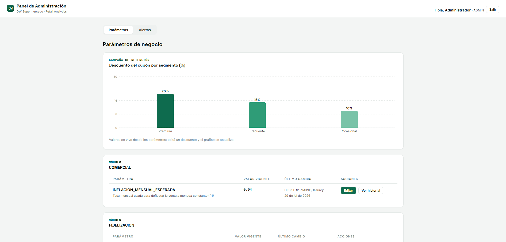
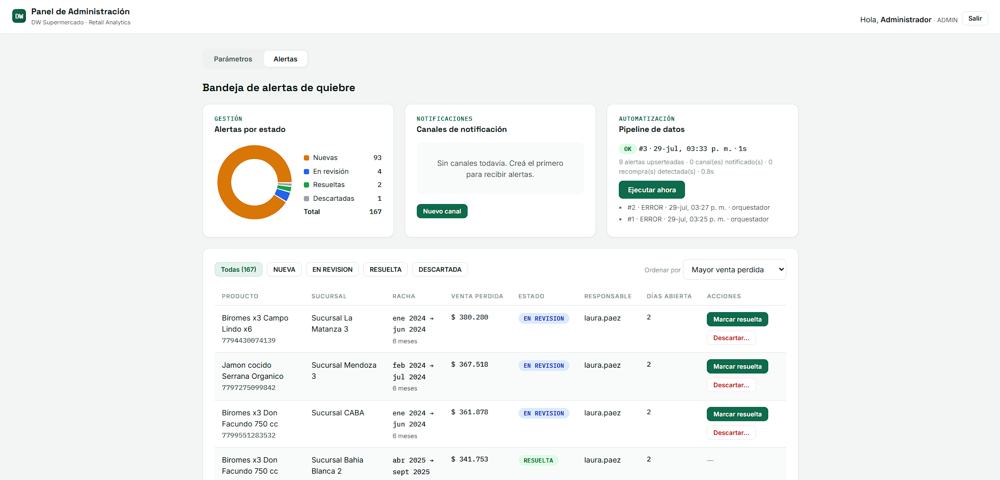

# 💻 Frontend - Panel de Administración Retail

Este es el cliente web construido con **React y Vite**, diseñado para que los gerentes de tienda y analistas comerciales interactúen con el Data Warehouse. Permite ajustar parámetros de negocio, gestionar alertas de quiebre de stock y configurar campañas de retención en tiempo real.

## 📸 Vistas del Panel


*Vista principal del panel operativo y KPIs.*


*Simulador en tiempo real: evaluación de impacto antes de guardar las reglas de negocio en la base de datos.*

## 🛠️ Tecnologías Principales

* **React 18 + Vite**: Renderizado ultrarrápido y Hot Module Replacement (HMR) instantáneo.
* **TanStack Query v5 (React Query)**: Manejo de estado del servidor, caché, sincronización y mutaciones.
* **React Hook Form + Zod**: Formularios altamente performantes (sin re-renders innecesarios) con validación de esquemas en el lado del cliente (compartiendo la misma lógica que la API).
* **Tailwind CSS**: Estilos utilitarios para una interfaz moderna, limpia y completamente responsive.

## 🌟 Características Clave

1. **Mutaciones Optimistas (Optimistic UI)**: Al cambiar el estado de una alerta (ej. de "NUEVA" a "RESUELTA"), la interfaz se actualiza instantáneamente sin esperar la respuesta del servidor, mejorando drásticamente la percepción de velocidad. Si la API falla, TanStack Query hace un *rollback* automático al estado anterior.
2. **Validación Espejada**: Gracias a **Zod**, las reglas de negocio (ej. "el descuento máximo no puede superar el 30%") se validan en el momento que el usuario tipea, antes de siquiera enviar el Request (evitando errores 400 innecesarios).
3. **Manejo de Sesión Segura**: Interceptor de peticiones HTTP que inyecta automáticamente el token JWT y reacciona de forma global a los errores 401 (deslogueando al usuario) o 403 (mostrando pantallas de acceso denegado según su rol RBAC).

## 📂 Estructura del Código

```text
frontend/
├── public/                  # Assets estáticos (favicon, logos)
├── src/
│   ├── assets/              # Imágenes y recursos del bundle
│   ├── components/          # UI Genérica (Botones, Modales, Inputs, Layouts)
│   ├── features/            # Componentes agrupados por dominio de negocio (Alertas, Campañas, Parámetros)
│   ├── hooks/               # Custom hooks (ej. useAuth, configuraciones de TanStack Query)
│   ├── lib/                 # Utilidades (cliente Axios/Fetch configurado, helpers de Tailwind)
│   ├── pages/               # Vistas principales atadas al enrutador
│   ├── App.jsx              # Definición de Rutas y Context Providers
│   └── main.jsx             # Entry point de React DOM
├── .env.local.example       # Plantilla de variables de entorno frontend
├── tailwind.config.js       # Configuración del design system de Tailwind
└── vite.config.js           # Configuración del bundler
```

## 🚀 Instalación y Ejecución

**Prerrequisitos:** Asegúrate de tener el [Backend API](../backend/README.md) en ejecución en el puerto `3001` antes de probar el panel.

1. **Instalar dependencias:**

   ```bash
   npm install
   ```

2. **Configuración (.env.local):**
   Duplica el archivo `.env.local.example` y renómbralo a `.env.local`. Verifica que apunte a la API de tu entorno local:

   ```env
   VITE_API_URL=http://localhost:3001/api
   ```

3. **Iniciar servidor:**

   ```bash
   npm start
   # o en modo desarrollo con auto-reload:
   # npm run dev
   ```

   La aplicación estará disponible en `http://localhost:5173`. 
   
   *Nota: Para ingresar, utiliza las credenciales creadas mediante el script CLI del backend.*