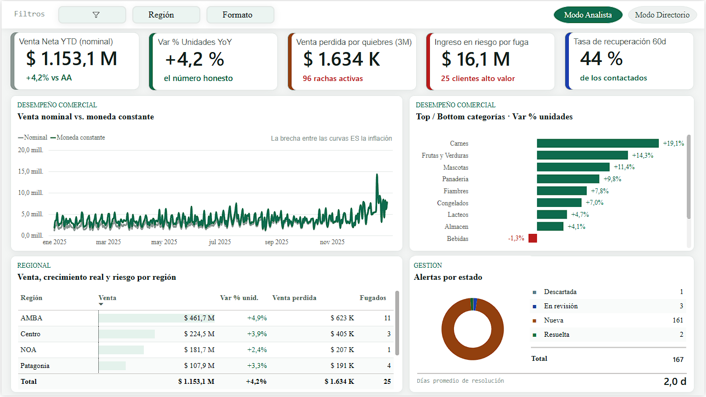
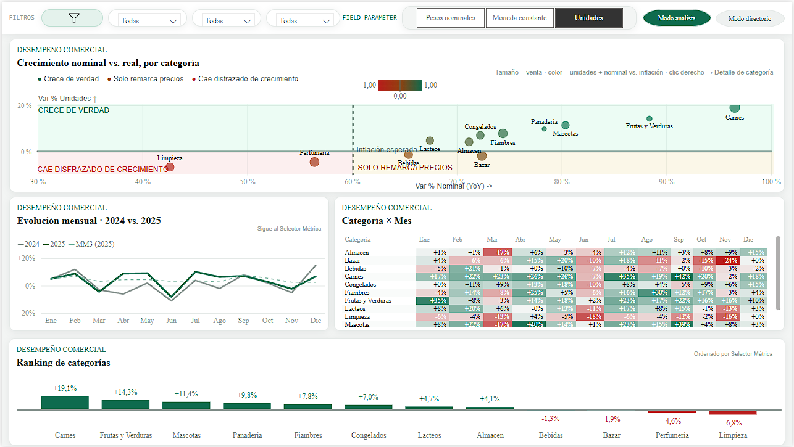
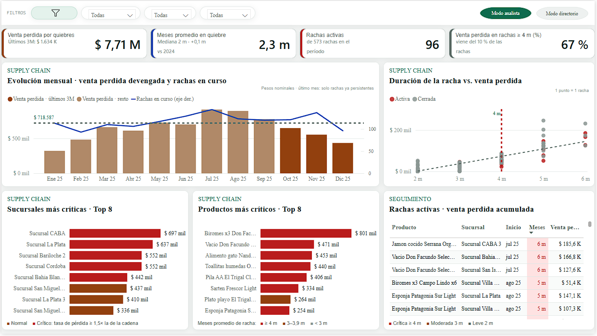
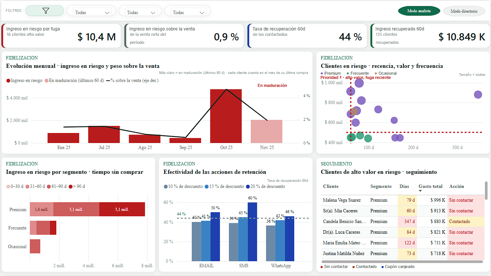

# 📊 Power BI - Capa Analítica y Dashboard

Esta carpeta contiene el proyecto de Power BI que actúa como la capa de visualización y análisis de nuestro Data Warehouse. A diferencia de un tablero tradicional que solo "lee" datos, este modelo cierra el ciclo operativo mostrando el impacto en tiempo real de las decisiones tomadas en el Panel de Administración web.

## 📸 Vistas del Tablero


*Vista general de KPIs comerciales y selector de moneda (Nominal vs Constante).*


*Evolución de ventas aislando la inflación y ranking de crecimiento por categorías.*


*Análisis de quiebres de stock persistentes y su costo financiero estimado.*


*Seguimiento de clientes de alto valor y métricas de recuperación post-campaña.*

## 🏗️ Arquitectura del Modelo Semántico

* **Modo de Conexión (Import Mode):** El modelo utiliza el modo *Import* para garantizar el máximo rendimiento analítico y habilitar todo el abanico de funciones DAX avanzadas (Time Intelligence, iteradores complejos).
* **Formato de Proyecto (PBIP):** El archivo está guardado como Proyecto de Power BI (`.pbip`) utilizando el formato **TMDL** (Tabular Model Definition Language). Esto es clave para el trabajo en equipo, ya que permite un control de versiones limpio en Git, mostrando exactamente qué medida DAX o metadato cambió en cada *commit*.
* **Esquema Híbrido:** El modelo importa datos analíticos limpios desde las tablas y vistas del esquema `dbo` (Estrella) y los cruza de forma inteligente con el esquema `app` (Alertas y Campañas) para medir la gestión.

## 🌟 Lógica de Negocio Avanzada (DAX)

### 1. Deflactación de Precios y Parámetros de Campo (Field Parameters)
En un contexto inflacionario, ver subir una curva de ventas en moneda nominal no indica crecimiento real. 
Se implementó un **Parámetro de Campo** dinámico que permite al usuario alternar los ejes y métricas de todo el tablero entre tres vistas con un solo clic:
* **Facturación Nominal:** Pesos argentinos corrientes.
* **Facturación Real (Moneda Constante):** Ajustado por inflación interanual basándose en la configuración del DW.
* **Volumen:** Unidades físicas vendidas (elimina la variable precio por completo).

### 2. Análisis de Churn y Retención por Cohortes
El tablero no solo muestra cuántos clientes se fugaron, sino que realiza un análisis de cohortes para medir la **efectividad de las campañas de retención**. 
Utilizando DAX, cruzamos la tabla operativa `app.AccionRetencion` (cuándo y a quién se le envió un cupón) con `dbo.FactVentas` para calcular la **Tasa de Recuperación a 60 días**. Evaluamos si el cliente volvió a comprar *después* de ser contactado y cuánto gastó en esa visita de "regreso".

### 3. Impacto Financiero de Supply Chain
Consumiendo la vista `vw_RachasQuiebre` (procesada previamente por el motor de T-SQL), Power BI visualiza las rachas de quiebre de stock cruzadas con la velocidad de venta histórica del producto, mostrando el *Venta Perdida Estimada* para priorizar la reposición desde el Centro de Distribución.

## 📂 Estructura de la Carpeta

```text
powerbi/
├── dashboard_retail.pbip      # Archivo principal de Proyecto de Power BI
├── dashboard_retail.Report/   # Definición visual del reporte (JSON/TMDL)
├── dashboard_retail.Dataset/  # Modelo semántico, conexiones y código DAX (TMDL)
├── medidas_powerbi.dax        # Archivo de respaldo con las medidas DAX clave en texto plano
└── README.md
```

## 🚀 Instrucciones de Uso

1. **Prerrequisitos:** Asegúrate de tener instalada la última versión de **Power BI Desktop** y de haber ejecutado los scripts de carga en tu SQL Server local.
2. **Abrir el proyecto:** Haz doble clic en el archivo `dashboard_retail.pbip`.
3. **Actualizar Datos:** Al abrir por primera vez, haz clic en **Actualizar (Refresh)** en la cinta de opciones para que Power BI importe los datos desde tu SQL Server local (pedirá credenciales de Windows o de Base de Datos según tu configuración).
4. **Desactivar Fecha Automática:** Para mantener el control de versiones limpio y no inflar el modelo, verifica en *Archivo > Opciones y configuración > Opciones > Archivo actual > Carga de datos* que la opción **"Inteligencia de tiempo automática (Fecha y hora automáticas)" esté desmarcada**.